# BY 

 Anderson Dos Santos Barbosa
 📧 andersonbarbosadeveloper@gmail.com
 💻 GitHub: AndersonSBarbosa
 https://www.linkedin.com/in/anderson-dos-santos-barbosa-7bb8a627/

 

# Zeeway Pedidos

API de pedidos em ASP.NET Core 8 com PostgreSQL, EF Core e integracao resiliente a um gateway ficticio.

## Estrutura

```text
Zeeway.Pedidos.sln
src/
├── Zeeway.Pedidos.Api/
│   ├── Controllers/
│   ├── Mapping/
│   ├── Middleware/
│   ├── Models/
│   └── Program.cs
├── Zeeway.Pedidos.Domain/
│   ├── Base.cs
│   ├── IdempotencyRecord.cs
│   ├── PagamentoEventRecord.cs
│   ├── Pedido.cs
│   ├── PedidoItem.cs
│   └── PedidoStatus.cs
├── Zeeway.Pedidos.Infrastructure/
│   ├── db/
│   ├── Interface/
│   ├── Migrations/
│   ├── Model/
│   ├── Repository/
│   ├── Security/
│   └── PagamentoGatewayClient.cs
└── Zeeway.Pedidos.Service/
    ├── Interface/
    ├── PagamentoWebhookService.cs
    └── PedidoService.cs
tests/
├── Zeeway.Pedidos.IntegrationTests/
│   ├── DatabaseSchemaCompatibilityTests.cs
│   └── PedidosApiIntegrationTests.cs
└── Zeeway.Pedidos.UnitTests/
    └── PedidoStateMachineTests.cs
```

- `Zeeway.Pedidos.Api` - endpoints HTTP, controllers, mapeamento e middleware.
- `Zeeway.Pedidos.Service` - casos de uso e orquestracao de pedidos e webhooks.
- `Zeeway.Pedidos.Domain` - entidades e regras de dominio.
- `Zeeway.Pedidos.Infrastructure` - persistencia, migrations e integracao com gateway.
- `Zeeway.Pedidos.UnitTests` - testes unitarios.
- `Zeeway.Pedidos.IntegrationTests` - testes da API e compatibilidade do banco.

Os nomes internos foram padronizados para `Pedidos` e `Pagamentos`; os contratos
JSON e os nomes de tabelas/colunas existentes foram mantidos para preservar compatibilidade.

## Como executar

Pre-requisitos: .NET 8 SDK e Docker.

```powershell
docker compose up --build
```

A API fica em `http://localhost:8080` e o Swagger em `http://localhost:8080/swagger`.

Execucao local:

```powershell
docker compose up postgres
dotnet run --project src/Zeeway.Pedidos.Api
```

Testes:

```powershell
dotnet test Zeeway.Pedidos.sln
```

Logs:

Erros nao tratados e falhas registradas pela aplicacao sao gravados diariamente
em arquivos `zeeway-AAAA-MM-DD.txt`, dentro da pasta `logs` ao lado dos binarios
da API. Cada registro inclui data/hora local, categoria (origem), mensagem e,
quando disponivel, detalhes e stack trace da excecao.

## Endpoints

- `POST /pedidos` - requer `Idempotency-Key`
- `GET /pedidos/{id}`
- `GET /pedidos?status=Pending&page=1&pageSize=20`
- `POST /webhooks/payments`
- `GET /health/live`
- `GET /health/ready`

O filtro de status aceita `Pending`, `Paid`, `Failed` e os nomes localizados
`Pendente`, `Pago`, `Falha`. As respostas continuam usando os valores legados.

Exemplo:

```json
{
  "customerEmail": "cliente@example.com",
  "items": [
    { "name": "Teclado", "quantity": 1, "unitPrice": 250.00 }
  ]
}
```

O webhook usa `X-Signature-SHA256` contendo o HMAC-SHA256 hexadecimal do corpo bruto. O segredo vem de `PaymentGateway:WebhookSecret`.

Payload aceito:

```json
{
  "event_id": "evt-123",
  "order_id": "GUID-DO-PEDIDO",
  "type": "payment.approved"
}
```

Tipos: `payment.approved` e `payment.failed`.

### Executar o webhook localmente

Use um `order_id` de um pedido existente (retornado por `POST /pedidos`). O segredo abaixo e o valor local de desenvolvimento em `appsettings.json`; em outros ambientes, use o segredo configurado para `PaymentGateway:WebhookSecret`.

```powershell
$base = "http://localhost:5038"
$pedidoId = "GUID-RETORNADO-PELO-POST-PEDIDOS"
$secret = "development-webhook-secret"

$body = @{
    event_id = "evt_$([guid]::NewGuid().ToString('N'))"
    order_id = $pedidoId
    type = "payment.approved"
} | ConvertTo-Json -Compress

$hmac = [System.Security.Cryptography.HMACSHA256]::new(
    [Text.Encoding]::UTF8.GetBytes($secret)
)
try {
    $signature = [BitConverter]::ToString(
        $hmac.ComputeHash([Text.Encoding]::UTF8.GetBytes($body))
    ).Replace("-", "").ToLowerInvariant()
}
finally {
    $hmac.Dispose()
}

curl.exe -X POST "$base/webhooks/payments" `
    -H "Content-Type: application/json" `
    -H "X-Signature-SHA256: $signature" `
    --data-raw $body

Invoke-RestMethod "$base/pedidos/$pedidoId" |
    Select-Object id, status, paymentId
```

O corpo usado para calcular a assinatura precisa ser exatamente o mesmo enviado. O esperado e HTTP 200 e status `Paid`. Para testar falha, troque `payment.approved` por `payment.failed`; para testar duplicidade, reenvie o mesmo corpo com a mesma assinatura.

### Enviar pelo Swagger

1. Use `POST /pedidos` no Swagger para criar um pedido e copie o `id` retornado.
2. Gere a assinatura do corpo exato que sera enviado. No PowerShell, substitua o GUID por esse `id`:

```powershell
$secret = "development-webhook-secret"
$body = '{"event_id":"evt-swagger-001","order_id":"GUID-DO-PEDIDO","type":"payment.approved"}'

$hmac = [System.Security.Cryptography.HMACSHA256]::new(
    [Text.Encoding]::UTF8.GetBytes($secret)
)
try {
    $signature = [BitConverter]::ToString(
        $hmac.ComputeHash([Text.Encoding]::UTF8.GetBytes($body))
    ).Replace("-", "").ToLowerInvariant()
}
finally {
    $hmac.Dispose()
}

$signature
```

3. No `POST /webhooks/payments`, clique em **Try it out**, cole o mesmo JSON de `$body` em uma linha e cole o valor de `$signature` no header `X-Signature-SHA256`.
4. Execute. O esperado e HTTP 200; consulte `GET /pedidos/{id}` para confirmar `Paid`.

Se alterar qualquer caractere do corpo ou usar outro `event_id`, gere uma nova assinatura. O Swagger mostra o campo, mas nao calcula o HMAC automaticamente.


## Trade-offs

Nao implementei Outbox, reconciliação assíncrona ou OpenTelemetry. Uma chamada de cobrança falha deixa o pedido `Pending`, pois a execução atual é síncrona e não possui worker de recuperação.


## Uso de IA

O projeto foi montado com auxílio do Copilot para o esqueleto da solução, entidades, EF Core, endpoints, testes e documentação.


## Evidências

### Criação do pedido

Chave de idempotência usada: `4bf5e806-12ba-4165-bd71-217a8b674f13`

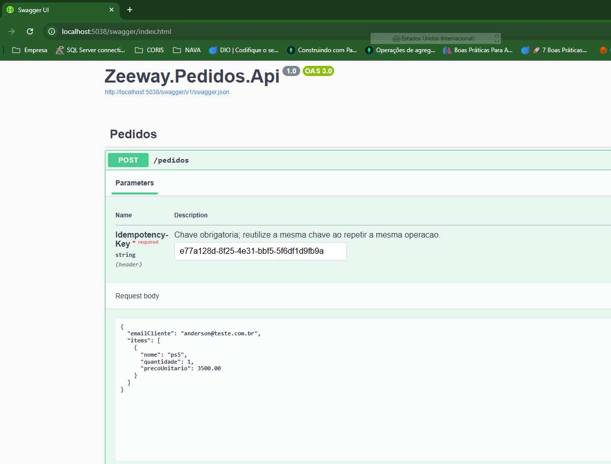

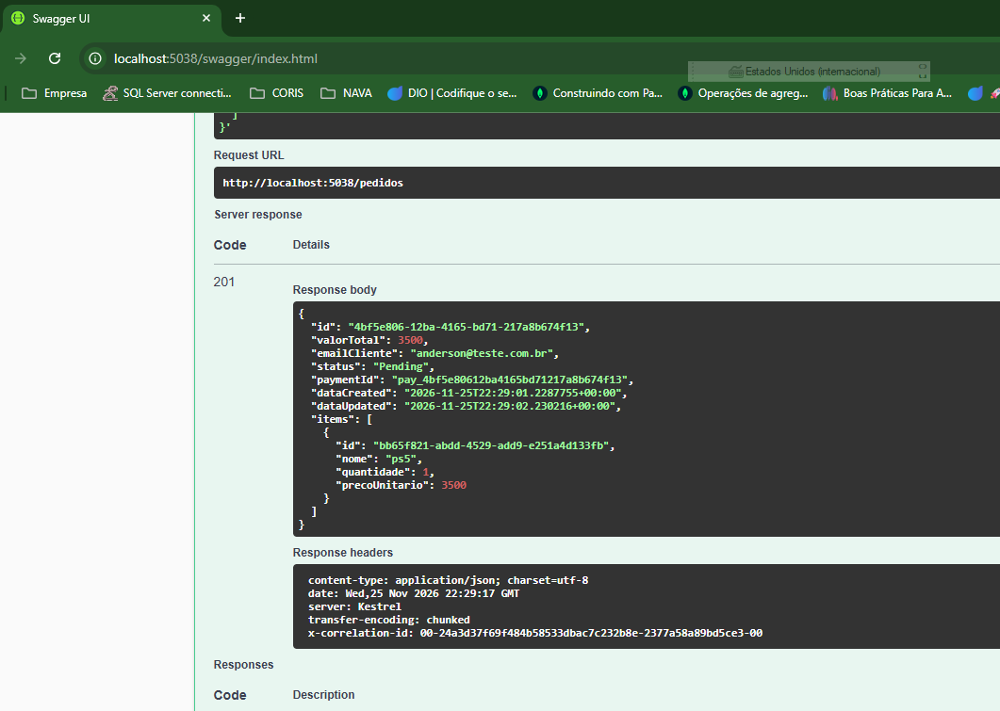

### Listar por status

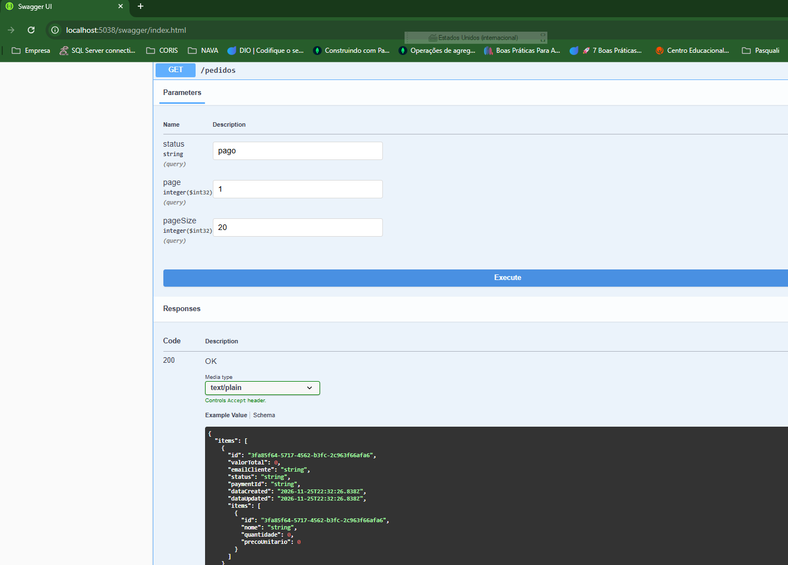

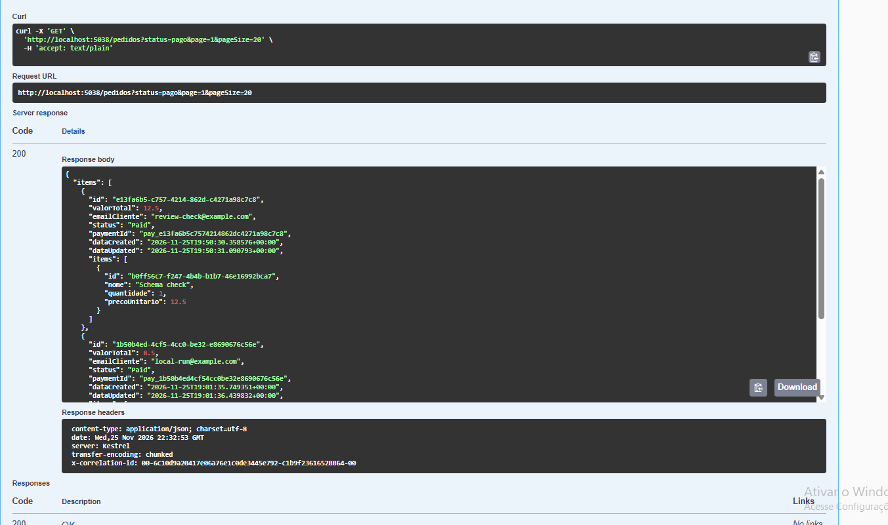

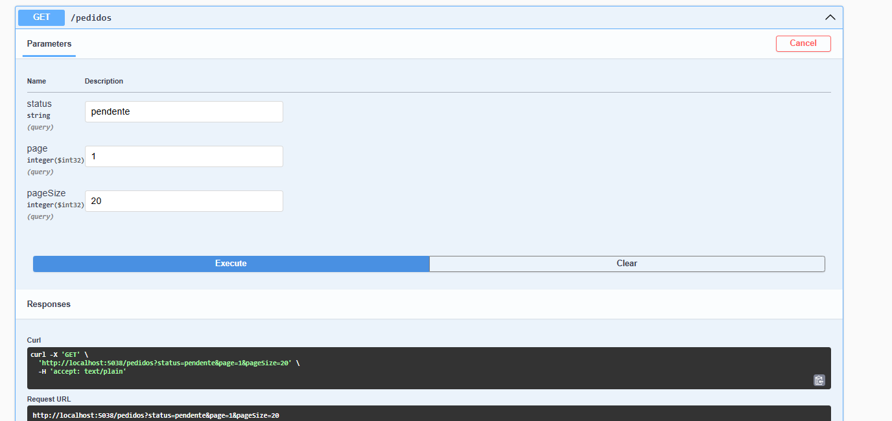

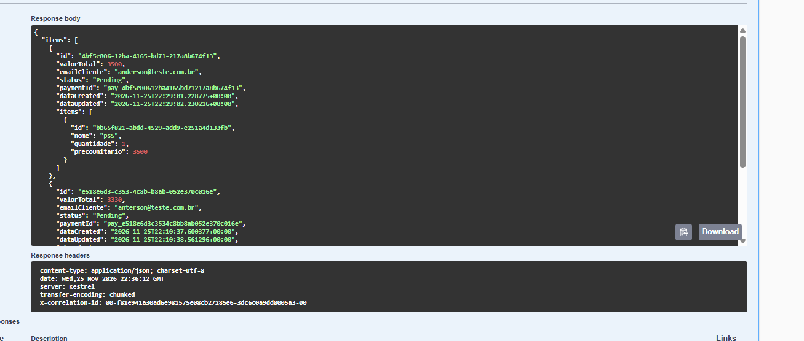


### Buscar por ID do pedido

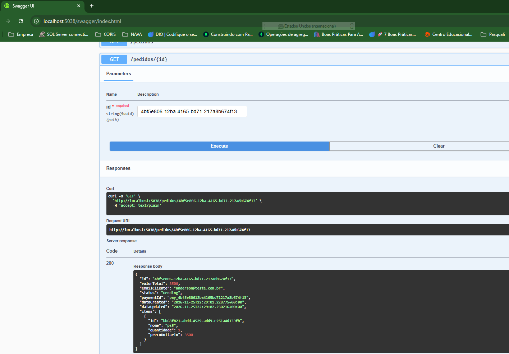


### Testes unitários

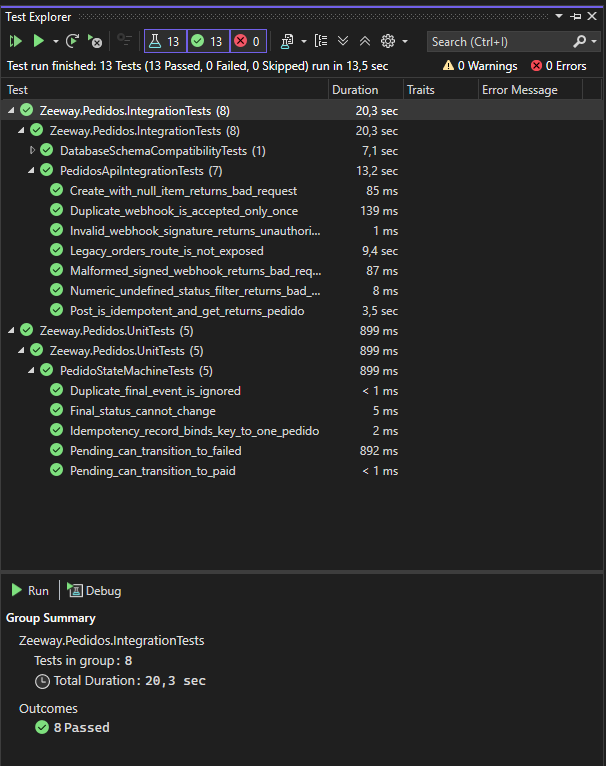


## Chave pra usar o Webhook
8e31315349ecab35c76c0723cccaf5d1d577d4254d97f20038da23c527feddf4

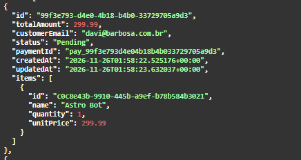

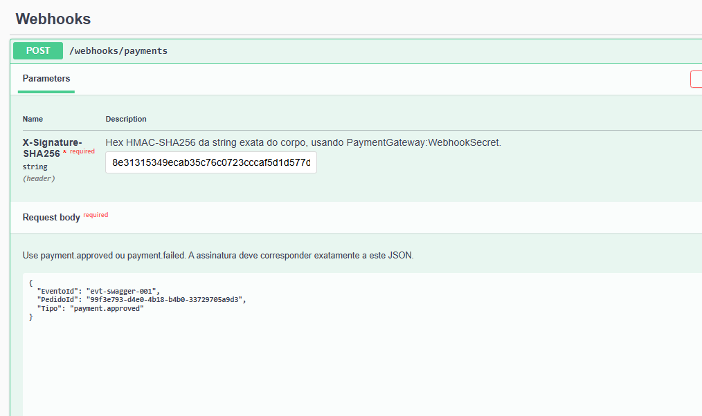

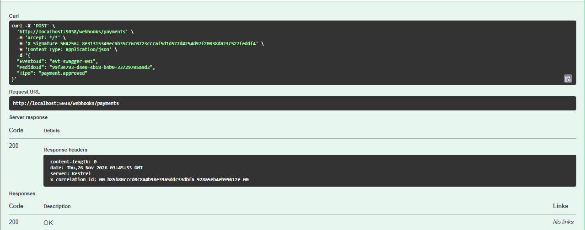

{
  "EventoId": "evt-swagger-001",
  "PedidoId": "99f3e793-d4e0-4b18-b4b0-33729705a9d3",
  "Tipo": "payment.approved"
}